<div align="center">

```
+--------------------------------------------------------------------+
|  PIXEL IT PARTNERS INTERACTIVE                         PRIVATE BETA|
|                                                                    |
|      __  __  ____  ____  ____  ___  __  __                        |
|     |  \/  |/ ___||  _ \/ ___||_ _||  \/  |                       |
|     | |\/| |\___ \| |_) \___ \ | | | |\/| |                       |
|     | |  | | ___) |  __/ ___) || | | |  | |                       |
|     |_|  |_||____/|_|   |____/|___||_|  |_|                       |
|                                                                    |
|            M  S  P     S  I  M  U  L  A  T  O  R                  |
|                                                                    |
|   "The year is 2014. The coffee machine has opinions."             |
|                                                                    |
|                       INSTRUCTION MANUAL                           |
|                                                                    |
|  +--------------------------------------------------------------+  |
|  | RATED E FOR EVERYONE                                         |  |
|  | Mild IT Jargon, Cartoon Nerf Violence,                       |  |
|  | Coffee Machine Opinions                                      |  |
|  +--------------------------------------------------------------+  |
|                                                                    |
|   1 OR 2 PLAYERS            SAVES: 3 SLOTS PER CAMPAIGN            |
|   DESIGNED FOR GODOT 4.7.2     PIXELS: DRAWN BY CODE, MOSTLY       |
+--------------------------------------------------------------------+
```

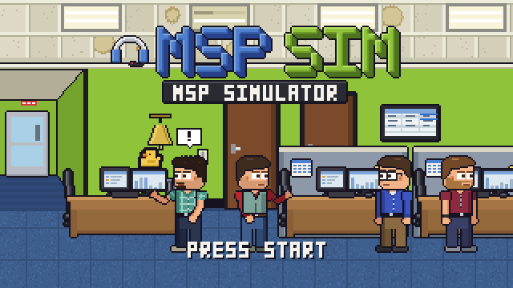

</div>

Thank you for choosing **MSPSim**, the cartoon pixel-art office sim about working at a managed service provider (an "MSP": the
small company that keeps other companies' computers alive). You will close tickets, answer phones, fix things from a chair and
sometimes from a van, and still find time for a foam dart war by the copier.

Please read this manual before you play. Or do not. Nobody reads these. But the controls are on page 2, and
there is a coffee machine you will want to find.

> **NOTE:** MSPSim is **private and in progress**. It is not for sale, not shipped, and some screens in this manual may be a
> little newer (or older) than the game on your machine. Where a page and the game disagree, believe the game and tell us.

---

## SCREENSHOTS

<table>
<tr>
<td width="50%">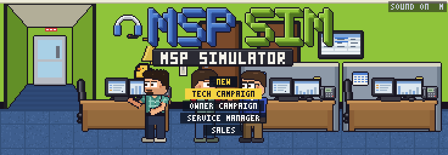<br><sub>Pick a campaign: tech, owner, service manager, sales, or free play.</sub></td>
<td width="50%">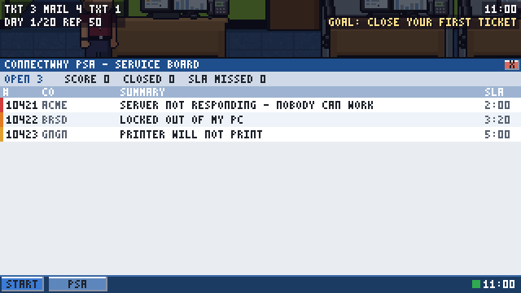<br><sub>The service board: tickets, SLA timers, and a computer frozen on a blue screen.</sub></td>
</tr>
<tr>
<td width="50%">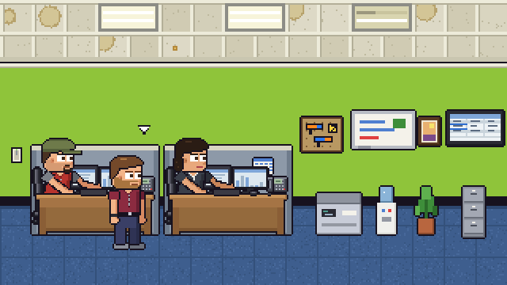<br><sub>The office, in cartoon pixels. Everyone has a desk and an opinion.</sub></td>
<td width="50%">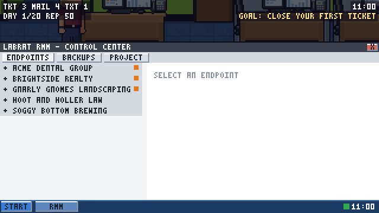<br><sub>The remote monitoring console: endpoints, backups and projects.</sub></td>
</tr>
<tr>
<td width="50%">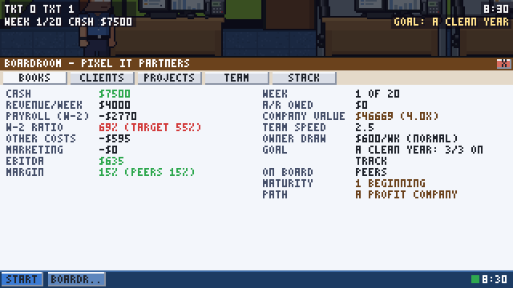<br><sub>The owner's Boardroom: the books of the company you now run.</sub></td>
<td width="50%">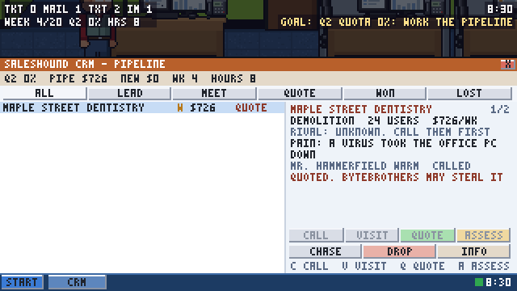<br><sub>The sales CRM: leads, quotes and who to call next.</sub></td>
</tr>
<tr>
<td width="50%">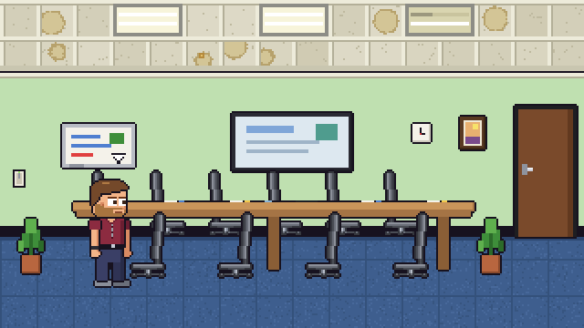<br><sub>The conference room, where handovers, reviews and bad news happen.</sub></td>
<td width="50%">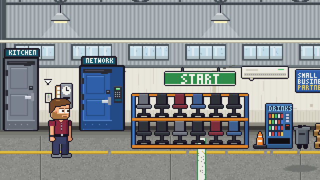<br><sub>The warehouse: racks, a drinks machine and a very large START sign.</sub></td>
</tr>
<tr>
<td width="50%">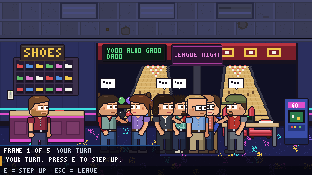<br><sub>After work: bowling night, one of nine team games.</sub></td>
<td width="50%">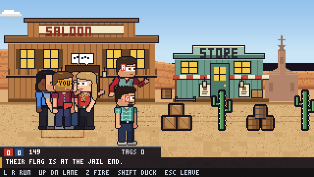<br><sub>Paintball: your team, their team, and a flag in the middle.</sub></td>
</tr>
<tr>
<td width="50%">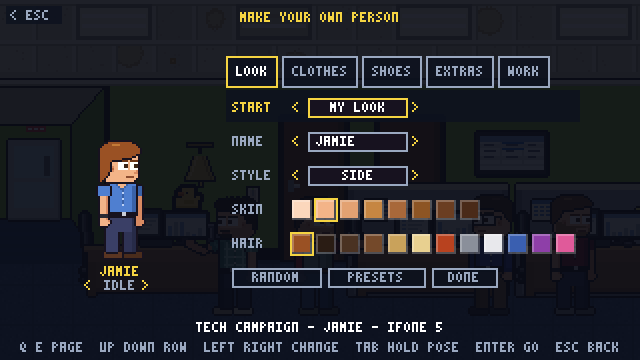<br><sub>Make your own person: look, clothes, shoes, extras.</sub></td>
<td width="50%">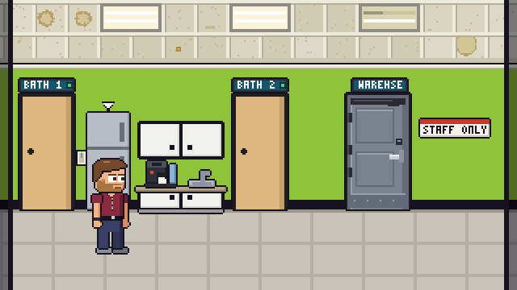<br><sub>The kitchenette: two bathrooms, a fridge and the coffee machine.</sub></td>
</tr>
</table>

---

## WHAT IS IN THE BOX

| | |
|---|---|
| **Four campaigns** | Tech, Owner, Service Manager and Sales: 20 working days (or weeks) each, with a year-end review. A finished year unlocks **Year 2**, and Year 2 unlocks **Year 3**. |
| **Free Play and Quick Play** | A sandbox with a toolbox (rooms, events, any team game, seeds), and a few minutes of play from the title screen: one outing or one ticket shift. |
| **An office to walk around** | Main floor, cubicles, conference room, kitchenette, network closet, warehouse and the lot behind it, plus client sites to drive to and a conference trip. |
| **A computer and a phone** | Mail, the service board, remote monitoring, chat, the owner's Boardroom, the sales CRM, Dispatch, and a phone with texts, contacts and a camera. |
| **Nine team games** | Bowling, karaoke, an escape room (four themes), dinner, chair races, paintball, cornhole, a cookout and darts. Foam dart wars happen on their own. |
| **Make your own person** | Hair, clothes, shoes, hats and glasses, saved in preset slots. |
| **A career** | 72 medals and a collection that carry over between runs. |
| **Three levels and seeds** | Easy (cozy), Normal and Hard. A seed replays the same year; there is a seed of the day. |
| **Keyboard, gamepad or touch** | The whole game plays on a gamepad. A second player can join on one. A 16:10 shape fits a Steam Deck. |

---

## CONTENTS

| | PAGE |
|---|---:|
| [WHAT IS IN THE BOX](#what-is-in-the-box) | 1 |
| [GETTING STARTED](#getting-started) (what you need, how to switch it on) | 2 |
| [SAVING](#saving) (three slots, like a memory card) | 3 |
| [CONTROLS AT A GLANCE](#controls-at-a-glance) | 4 |
| [THE FULL MANUAL](#the-full-manual) (nine chapters, with pictures) | 5 |
| [FOR TINKERERS](#for-tinkerers) (tests, generators, here be scripts) | 6 |
| [CREDITS](#credits) | 7 |

---

## GETTING STARTED

### What you need

| ITEM | NOTES |
|---|---|
| **Godot 4.7.2** | The standard build (not .NET). Get it at [godotengine.org/download](https://godotengine.org/download). |
| A computer that can run a 2D game | The game renders in OpenGL Compatibility mode, so a toaster from this decade will do. |
| A keyboard or a gamepad | Everything can be played on either. A mouse helps in the computer and phone screens. |
| Coffee | Optional. The in-game machine is a prop with feelings, not a supply. |

> **NOTE:** Please do not insert a disc. There is no disc. Please do not blow on anything either.

### Switching it on

From the folder you downloaded, run:

```
Godot --path godot
```

Or open `godot/project.godot` in the Godot editor and press **F5**.

### The very first time (the import)

The first time you run a fresh copy, Godot has to look over every picture and sound before it can use them. Do it once, up front, and
the game will start in seconds from then on:

```
Godot --headless --path godot --import
```

> **TIP:** If you skip this and press F5 anyway, Godot will do the same thing in the editor with a progress bar. It is the same
> import, just with more waiting and a view.

### Formats and the F9 key

MSPSim was built to be filmed as well as played, so the picture comes in five shapes. Press **F9** at any time (title screen, menus
and rooms) to cycle through them.

| SHAPE | SIZE | WHAT IT IS FOR |
|---|---|---|
| `wide` | 368 x 128 | The original: the whole office in one long strip. |
| `h` | 320 x 180 | 16:9 widescreen. The comfortable default for most screens. |
| `deck` | 320 x 200 | 16:10, the whole screen of a Steam Deck. |
| `v` | 180 x 320 | 9:16 portrait, for phones and for video that goes vertically. |
| `vclose` | 180 x 320 | The same portrait, zoomed in 2x on the action. |

> **NOTE:** The game starts **full screen**, in the shape that fits your screen (`h` on 16:9, `deck` on 16:10), always at a whole
> multiple of the size above so every pixel stays square. **SETTINGS** on the title screen has **DISPLAY** (full screen or a
> window; `Alt`+`Enter` does the same anywhere), **SHAPE** (the same as F9) and **UNFOCUSED** (pause, or keep running, when
> you look at another window). Your choices are remembered.

---

## SAVING

MSPSim saves like a console from the memory-card era: you get **three slots for each campaign**, they are kept on your computer
(not in the cloud, not on a card), and nobody will ask you to remove the card before powering off.

| WHEN | WHAT HAPPENS |
|---|---|
| **End of each working day** | The game saves to your slot by itself. |
| **You pause or close the window mid-day** | A resume point is kept, so **CONTINUE** drops you back where you stood. |
| **Start a new campaign** | It takes the first empty slot. If all three are full the game asks which one to overwrite (and has a CANCEL button, like a polite person). |
| **Free Play** | Nothing is saved. It is a sandbox. Go wild. |

On the title screen, a campaign with saved games lists each slot with its day and your character's name. Choose a slot to
continue, or **NEW CAMPAIGN** to start another.

> **WARNING:** Do not unplug the network closet during business hours. (Saves are unaffected. Everyone's mood is not.)

The full details are in [Chapter 1: Getting Started](docs/manual/01-getting-started.md#saving-your-game).

---

## CONTROLS AT A GLANCE

| ACTION | KEYBOARD | GAMEPAD |
|---|---|---|
| Walk | `A` `D` or arrow keys | Left stick or D-pad |
| Run | Hold `Shift` | `B` (hold) |
| Jump | `Space`, `W` or Up | `A` |
| Duck | `S` or Down | Down on the D-pad or stick |
| Use / sit / talk / open | `E` | `X` |
| Pick the next target | `Tab` (`Shift`+`Tab` goes back) | `RB` |
| Phone | `P` | `Back` / `Select` |
| Wave / sip your drink | `Q` / `F` | `Y` / `LB` |
| Dance | `X` (the key, not the pad) | Right stick up |
| Ask a coworker to follow you | `C` next to them | Right stick down |
| Nerf blaster | Tap `Z` to fire, hold to aim | `RT` |
| Roll your chair | Seated: hold `Shift` + `A`/`D` | none |
| Mute the sound | `M` | Right stick right |
| Pause and the key list | `Esc` or `Pause` | `Start` |
| Change the picture shape | `F9` | SETTINGS, SHAPE |
| Full screen or a window | `Alt`+`Enter` | SETTINGS, DISPLAY |
| Hide the clock and counters | `F10` | none |

> **TIP:** The pause menu has a **CONTROLS** page that lists these keys in-game. Press `Esc` and have a look.

All the controls, with what every one of them does and what changes while you are seated, are in
[Chapter 2: Controls](docs/manual/02-controls.md).

---

## THE FULL MANUAL

The complete instruction manual lives in [`docs/manual/`](docs/manual/README.md). It is spoiler-free: it explains how to
**get around** this lovely story, not how it ends.

| CHAPTER | WHAT IT COVERS |
|---|---|
| [1. Getting Started](docs/manual/01-getting-started.md) | Launching, the title screen, difficulty (including cozy Easy), seeds, save slots, the pause menu |
| [2. Controls](docs/manual/02-controls.md) | Every key and button, seated and standing |
| [3. Game Modes](docs/manual/03-game-modes.md) | Tech, Owner, Service, Sales, Free Play and Career |
| [4. The Office](docs/manual/04-the-office.md) | A guided tour and a map of the building |
| [5. Your Computer and Phone](docs/manual/05-your-computer-and-phone.md) | The apps, the HUD counters, how the screens work |
| [6. After Work](docs/manual/06-after-work.md) | Bowling, karaoke, the escape room and the rest |
| [7. Make Your Own](docs/manual/07-make-your-own.md) | The character creator and your wardrobe |
| [8. Tips and Troubleshooting](docs/manual/08-tips-and-troubleshooting.md) | Questions, answers and the Free Play toolbox |
| [9. Credits and Legal](docs/manual/09-credits-and-legal.md) | The limited warranty and customer support |

---

## FOR TINKERERS

This section is for people who want to look under the case. If you only want to play, you may stop reading here, and
you will not be missing anything. (Okay, you will be missing the warranty. It is in Chapter 9.)

### Where things live

| PATH | WHAT IS IN IT |
|---|---|
| `godot/` | The game itself (Godot 4.7 project, GL Compatibility). |
| `godot/story/strings.txt` | Every line of story text in one plain file. Edit it and the game changes. |
| `godot/scripts/` | The game scripts. |
| `godot/tests/` | The headless test suite and the screenshot scripts. |
| `tools/` | Lua scripts for Aseprite (all art is drawn by code and Aseprite pixels), the script generator and the test runner. |
| `docs/GAME_BIBLE.md` | The pitch, the cast and the design. Written for reviewers. Contains story: **spoilers**. |
| `docs/ROADMAP.md` | What is built and what is next. |
| `CLAUDE.md` | The long technical notes (art pipeline, scene generation, systems). |

### Tests

```
python tools/run_tests.py -j 4        # the full headless suite
python -I tools/check_generator.py     # the generated scripts match the generator
cd godot && gdlint scripts tests       # lint
```

> **WARNING:** `godot/scripts` is generated by `tools/make_godot.py` but is also hand-edited in step with it. **Do not rerun the
> generator in the real tree.** Use the check script above, which compares without overwriting.

### Taking your own screenshots

The pictures on this page come from `godot/tests/readme_shots.gd`: it walks the screens, lets each one settle and saves them
at 2x to the game's user folder (`readme/`), from where they are copied to `docs/manual/img/`. Run it with the project's
Godot, **without** `--headless`, and with `MSPSIM_TEST=1` in the environment so the window stays a window:
`Godot --path godot --fixed-fps 60 --script res://tests/readme_shots.gd`. Any other `godot/tests/*_shots.gd` shows the same
pattern for a single screen.

---

## CREDITS

Pixel art drawn in [Aseprite](https://www.aseprite.org); characters and rooms built by Lua scripts so every animation works on every
person. Built with [Godot](https://godotengine.org). Made by Ben and a very patient robot.

*All company, product and brand names in MSPSim are parody. Any resemblance to a real MSP is entirely because every MSP is like this.*

<div align="right"><sub>PAGE 1 OF 7 &nbsp;|&nbsp; PIXEL IT PARTNERS INTERACTIVE &nbsp;|&nbsp; PRINTED IN YOUR BROWSER</sub></div>
