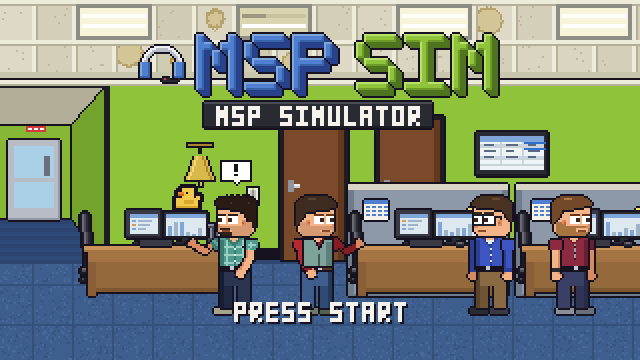
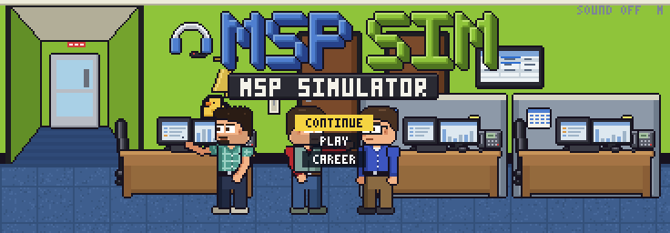
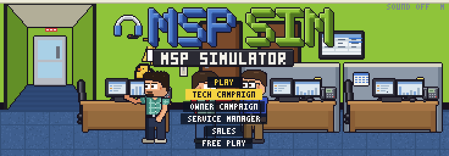
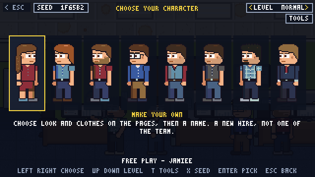
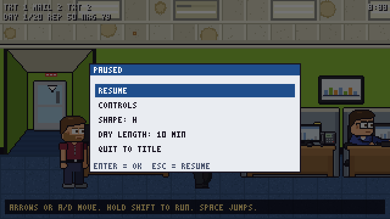
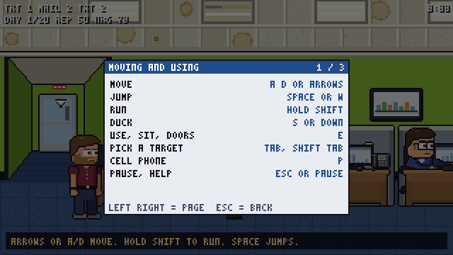

MSPSIM INSTRUCTION MANUAL &nbsp;|&nbsp; CHAPTER 1 &nbsp;|&nbsp; PAGE 2

# GETTING STARTED

*Switching it on, finding the menu and not losing your place.*

---

## SWITCHING IT ON

1. Make sure you have **Godot 4.7.2** (the standard build).
2. Import the game's pictures and sounds once: `Godot --headless --path godot --import`.
3. Run it: `Godot --path godot`, or open `godot/project.godot` in the editor and press **F5**.

The game starts at the title screen. If it does not, see [Chapter 8: Tips and Troubleshooting](08-tips-and-troubleshooting.md).

> **NOTE:** The first run on a fresh copy may sit on a progress bar while Godot reads every sprite. That is the import. It is
> not frozen. It is thinking, which is more than the office printer can say.

---

## THE TITLE SCREEN

Behind the logo, the office puts on little scenes for you: a lineup by the desks, two people on the phones, the coffee machine,
a meeting in the conference room. They rotate every few seconds. Nobody is paid to do this.

**To begin, press `Enter`, `Space` or `E`, or click.** The home menu opens.

| HOME LINE | WHAT IT IS |
|---|---|
| **CONTINUE** | Only shown once you have a save. Lists your newest saves from every campaign, most recent first, and the list scrolls when there are more than six. |
| **PLAY** | Opens the list of modes below. |
| **CAREER** | Your medals, records and unlocks across every run. |
| **QUIT** | Leaves the game. |

**PLAY** shows five lines. `Esc` goes back to the home menu.

| PLAY LINE | WHAT IT IS |
|---|---|
| **TECH CAMPAIGN** | The main game: a service desk tech's working days. |
| **OWNER CAMPAIGN** | The same office from the owner's chair. |
| **SERVICE MANAGER** | Running the desk instead of working it. |
| **SALES** | The account manager's side of the building. |
| **FREE PLAY** | A sandbox with no scoring. |

There is a one-paragraph tour of each in [Chapter 3: Game Modes](03-game-modes.md).

### Using the menu

| ACTION | KEYBOARD | GAMEPAD | MOUSE |
|---|---|---|---|
| Move the highlight | `Up` / `Down` | D-pad or left stick | Hover |
| Choose | `Enter`, `Space` or `E` | `A` | Click |
| Go back | `Esc` | `B` | none |
| Change the picture shape | `F9` | none | none |
| Mute or restore the sound | `M` (the title shows `SOUND ON` / `OFF`) | none | none |

> **NOTE:** On the title menu the letter keys do not move the highlight, only the arrows do. This is so that `E` can mean "OK"
> without anybody having to think about it.

### The submenu and your slots

Choose a campaign and, if you already have saved games in it, a submenu appears:

| ROW | WHAT IT DOES |
|---|---|
| **SLOT 1 - DAY 7 ... - NAME** | One row for each save you have. It shows the day (or week), the time if there is one, and your character's name. Choose it to carry on. |
| **CONTINUE** / **DAY n FROM THE START** | Appears when a slot has both a mid-day resume point and a start-of-day save. CONTINUE puts you back exactly where you were. FROM THE START replays that day. |
| **START YEAR 2** | Appears once you have finished a campaign's first year. See [Chapter 3](03-game-modes.md#year-2). |
| **NEW CAMPAIGN** | Starts a fresh run in the first empty slot. |

If you have no saves, **NEW CAMPAIGN** is the only door, so the game just opens it for you.

---

## CHOOSING YOUR PERSON

A new run goes through a short "pick your character" screen. You walk through it with the arrows and `Enter`, and `Esc` takes you
back a step.

| CONTROL | WHAT IT DOES |
|---|---|
| `Left` / `Right` | Look along the row of people. |
| `Enter` (`E`, `Space`) | Pick the highlighted person and go on. |
| `Up` / `Down` | Change the **LEVEL** (difficulty). See below. |
| `X` | Open the **SEED** page. See below. |
| `T` | Open the toolbox (Free Play only, [Chapter 8](08-tips-and-troubleshooting.md#the-free-play-toolbox)). |
| `F9` | Change the picture shape. |
| `Esc` | Back. |

Some modes let you play as a person who already works at the office; others let you **make your own** (that card has its own
chapter: [Chapter 7: Make Your Own](07-make-your-own.md)). Depending on the mode, the screens after this one may also ask which
phone you carry and how to spend a handful of skill points on your starting build.

> **NOTE (COMING SOON):** This screen is being simplified so that it opens straight into the creator. Everything on it
> stays, but the order may change.

---

## DIFFICULTY

There are three levels, shown by the **LEVEL** chip at the top of the character select screen. Press `Up` or `Down` there to
change it. The game remembers your choice for next time.

| LEVEL | THE IDEA |
|---|---|
| **EASY** | Friendly timing everywhere. Inside a campaign, Easy is also the **cozy** mode (see below). |
| **NORMAL** | How the game was meant to be played the first time. |
| **HARD** | Tighter windows and stricter timers. Always beatable, never polite about it. |

The level reaches into every little game too: how fast the bowling markers swing, how much time you get in the escape room,
how generous the karaoke notes are, and so on.

### Cozy mode (Easy, inside a campaign)

Easy is the "wander and chat" setting. In a campaign, it softens the things that nag:

- Ticket timers are more forgiving, and being tired does not make your fixes fail.
- Your standing with the office has a floor, so there is no downward spiral. A rough stretch gets a gentle word, not a
  dramatic one.
- In the campaigns that handle money, a one-time rescue is available if the books run dry.
- The energy meter drains more slowly.

The pause menu shows a small **COZY** tag when it is on.

> **TIP:** Cozy does not take any of the puzzle away. You can still do everything the other levels can. It just has more patience.

---

## THE SEED AND THE DAILY SEED

Every run has a **seed**, a six-character code (like `29C110`) that decides the dice: which tickets come, which codes the escape
room picks, how the printer misbehaves. **The same seed on the same level gives the same dice**, so you can share one with a friend
and compare notes.

On the character select screen, press `X` (or click the **SEED** chip) to open the seed page:

| ROW | WHAT IT DOES |
|---|---|
| **The text box** | Type or paste a code (hex such as `4F2A9C`), or any word at all. A word is turned into a seed. |
| **RANDOM** | Roll a fresh code. |
| **TODAY** | Use today's seed (shown with the date, like `03 NOV`). It comes from the date on your computer's clock, so everyone who picks TODAY on the same day plays the same dice. |

`Up` and `Down` (or `Tab`) move between the three rows, `Enter` does whatever row you are on, and `Esc` closes the page.

---

## SAVING YOUR GAME

Think of it as a memory card with room for three. (It is not, in fact, a memory card. Please keep your memory cards out of the keyboard.)

- **Each campaign has three slots.** Tech, Owner, Service and Sales keep their own separate sets of three.
- **The game saves by itself** at the end of every working day.
- **A mid-day resume point** is kept when you open the pause menu, switch to another window, or close the game. That is what the
  **CONTINUE** row restores.
- **Free Play is not saved.** The pause menu even tells you so when you try to quit.
- **Your look, your level and your sound setting** are remembered between runs, in a small settings file next to the saves.
- When all three slots are full and you start another campaign, the game asks **OVERWRITE WHICH SLOT?** The row you pick is the confirmation,
  and **CANCEL** keeps all three.

> **WARNING:** Overwriting a slot is final. There is no undo, and there is no one to ring about it.

---

## THE PAUSE MENU

Press **`Esc`** (or the **`Pause`** key, or **`Start`** on a gamepad) while you are walking around a room. Everything stops: the clock,
the coworkers, the ticket timers.

| ROW | WHAT IT DOES |
|---|---|
| **RESUME** | Back to work. |
| **CONTROLS** | A three-page list of the keys. `Left` / `Right` turn the pages, `Esc` closes it. |
| **SHAPE: ...** | The picture shape. Same as **F9**: `Left` / `Right` or `Enter` cycles it. |
| **DAY LENGTH: 10 MIN** | In a campaign only. Cycle the length of a working day (5, 10 or 15 minutes in the tech campaign), which starts at the **next morning**. |
| **OUTFIT** | Free Play only, in place of DAY LENGTH. Opens the character creator over the room. |
| **QUIT TO TITLE** | Asks first: **NO, KEEP PLAYING** / **YES, QUIT**. In a campaign it says `YOUR LAST SAVE IS KEPT`. In Free Play it says `FREE PLAY IS NOT SAVED`. |

> **NOTE:** `Esc` does not open the pause menu while a computer, your phone, a card, an outing or a report is on screen, because
> those use `Esc` to close themselves. The **`Pause`** key still works over most of them.

> **TIP:** DAY LENGTH is a mercy and a challenge in one: 5 minutes makes a brisk day, 15 gives you room to chat.

---

## WHERE TO NEXT

- Learn the keys: [Chapter 2: Controls](02-controls.md)
- Pick a job: [Chapter 3: Game Modes](03-game-modes.md)

[Contents](README.md) &nbsp;|&nbsp; Next: [Chapter 2: Controls](02-controls.md) &gt;&gt;
