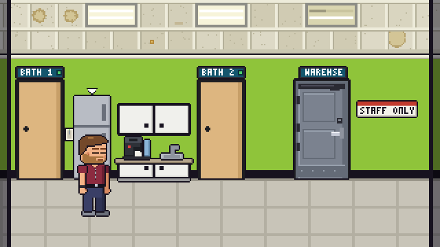
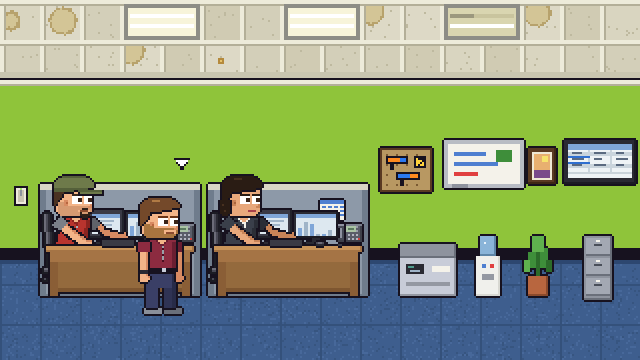
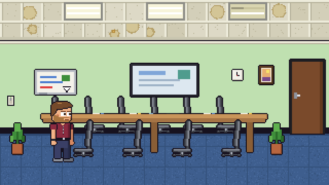
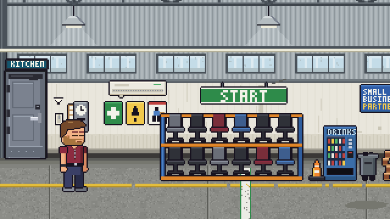

<sub>MSPSIM INSTRUCTION MANUAL &nbsp;|&nbsp; CHAPTER 4 &nbsp;|&nbsp; PAGE 13</sub>

# THE OFFICE

*A guided tour of Pixel IT Partners, its doors, its machines and the places the good coffee is not.*

---

## HOW TO GET AROUND

The building is a **side-on strip**: you walk left and right, rooms are joined by doors and by the edges of the screen.

| IF YOU SEE... | DO THIS |
|---|---|
| A **door** with a floating arrow over it | Stand next to it and press `E`. |
| The **edge of the room** (nothing in your way) | Keep walking. Edge exits fire when you touch them. |
| A **grey, shaking arrow** | The door is locked or busy. Try again later. |
| **Several things** within reach | Press `Tab` to move the arrow to the next one. |
| A **chair** | Press `E` to sit. Move to stand up. |

In the wider shapes the whole room fits on screen. In the narrow portrait shapes (`v`, `vclose`) the camera follows you instead.

> **TIP:** The arrow over a thing is a promise. If it is not there, `E` will not do anything. If it is there and `E` does nothing,
> somebody else is using it.

---

## THE MAP

```
  CONFERENCE <===> CUBICLE AREA <===> MAIN FLOOR <===> KITCHENETTE <===> WAREHOUSE <===> LOT
       ^                                 |  |  |           |    |             |
       |                                 |  |  |         BATH  BATH        NETWORK
       +---- (the far door: a shortcut) -+  |  |          1     2           CLOSET
                                            |  +-- FRONT DOOR (out to the car)
                                         OFFICE 1 / OFFICE 2
```

| ROOM | WHAT IS IN IT | EXITS |
|---|---|---|
| **MAIN FLOOR** | Three desks, a wall TV, a light switch, a bell on the wall and a lot of opinions. | Left edge to the **Kitchenette**. Right edge to the **Cubicle Area**. Doors to **Office 1** and **Office 2**. The **front door** (far left) leads out. |
| **OFFICE 1 and OFFICE 2** | Private rooms, each with desks and a computer. | One door, back to the main floor. |
| **KITCHENETTE** | The coffee machine, the fridge, a light switch. | Right edge to the main floor. Doors **BATH 1** and **BATH 2**. The grey steel door **WAREHSE** to the warehouse. |
| **BATHROOMS** | One person at a time. | Back to the kitchenette. |
| **CUBICLE AREA** | Two desks, the nerf rack, the copier, the water cooler and another wall TV. | Left edge to the main floor. Right edge to the **Conference Room**. |
| **CONFERENCE ROOM** | A long table, six chairs, a screen on the wall and a light switch. | Left edge to the cubicle area. The far door to the main floor. |
| **WAREHOUSE** | A very long room: chair rack, vending machine, parts cage, dart board, cornhole boards, a grill, an old Christmas tree and a big overhead door. | Left door back to the kitchenette. A blue steel door marked **NETWORK**. The overhead doorway to the lot. |
| **NETWORK CLOSET** | One rack and the things plugged into it. | The blue door, back to the warehouse. |
| **LOT** | The parking lot out back, with a dumpster and a lamp post. | The doorway back to the warehouse. |

> **NOTE:** There is no door from the main floor to the warehouse. The way to the back goes **through the kitchenette**, because
> the people who designed the building thought the kitchen was the natural place to put the loading dock.









---

## THINGS TO POKE

You can probably guess most of these by looking. Here is the short list of what `E` does.

| THING | WHAT HAPPENS |
|---|---|
| **A chair at a desk** | You sit. With a computer in front of you, `E` opens it. |
| **The computer** | Your screen takes over: [Chapter 5](05-your-computer-and-phone.md). |
| **A desk phone** | When it rings, press `E` to answer. A caller is on the line. |
| **The wall TV** | Opens the live metrics board full size, read only. `Esc` closes it. |
| **The coffee machine** | Pours a cup. You carry it until you drink it. |
| **The fridge** | Hands you a drink. |
| **The water cooler** | Hands you a cup of water. |
| **The copier** | It whirs into action. It is the closest thing the office has to a hobby. |
| **A light switch** | Turns the room's lights on and off. Nobody will thank you for the dark. |
| **The nerf rack** | Take a blaster. See [Chapter 2](02-controls.md#the-nerf-blaster). |
| **A coworker** | `E` to talk. `C` to ask them to follow you. |
| **The rubber duck on a monitor** | It squeaks. It stares. It listens. |
| **The bell on the main floor wall** | Belongs to the sales team. Hands off. |
| **The dart board** | Offers a quick round of darts: see [Chapter 6](06-after-work.md#darts). If a round cannot start right now, it just makes a comment about your aim. |
| **The vending machine** | Takes a coin, clunks, and hands you a soda or a bottle of water. Now and then it eats the quarter. Press `E` again and thump it. |
| **The chair rack** | Rolls a chair out across the front, squeaking, and takes it back after a while. |
| **The parts cage** | A peek inside with a flashlight. It is mostly junk. Sometimes it is not. |
| **The bench PC** | Says how far along the image is. Press `E` again soon after and you restart it. Somebody will notice. |
| **The pull chain** | Hangs from the high bay light over the back of the warehouse. Pulling it makes the light think about it. |
| **The radio** | On the bench. Each press tunes the next of three stations, and the fourth turns it off. |
| **The floor fan** | Starts or stops. It moves the heat around. |
| **The old Christmas tree** | Look, but also press `E`. Once. See what you find. |
| **The overhead door and its switch** | Rolls the big door up or down, which is how the lot opens. |
| **The sink and the toilet** | They work. We will not go into it. |
| **A bathroom door** | Opens only when nobody is inside, and says `OCCUPIED` when somebody is. |

> **WARNING:** Do not unplug the network closet during business hours. Everyone will know. The ones who do not know will be told.

---

## THE NETWORK CLOSET

Behind the warehouse, through the blue steel door marked **NETWORK**, is a small tiled room with one rack in it. This is where the
office's network actually lives. Cables run from the rack to the desks.

Stand anywhere in the closet and every plug in the rack is within reach. Use `Tab` to move the arrow from one port to the next, and
`E` to pick up or put down a cable end.

> **NOTE:** This is not a prop. The cables are real, in the sense that a desk whose cable you pull will lose its network, its
> screen will say so, and the person at that desk will notice.

> **NOTE (COMING SOON):** The closet is being reworked, with cables you can trace from one end to the other. The idea (a rack, and
> cables to plug and unplug) is staying.

---

## THE WAREHOUSE AND THE LOT

The warehouse is the longest room in the game, so in the wider shapes the camera scrolls to follow you. Walk right and you pass the
staging racks, the parts cage, a bench with a PC being imaged, the dart board, the cornhole boards, the grill at the dock and the old
tree at the far end. Most of it can be poked: the vending machine, the chair rack, the parts cage, the bench PC, the pull chain of the light over the back
room, the radio, the fan, and the tree's lights (the first press on the tree is the one that matters, after that it switches the lights on and off, and now and
then a bulb pops). None of these ever takes `E` away from a door.

The **overhead door** at the dock is controlled by a switch on the wall and by the door itself. Roll it up and the **doorway to the lot** opens.
Leave it down and the doorway is locked, and the game says `THE DOOR IS SHUT. ROLL IT UP FIRST.`

> **TIP:** Some of the after-work games are played here. The warehouse is a very flexible room.

---

## LEAVING THE BUILDING

The **front door**, far left of the main floor, is the way out to the car. When there is somewhere to go, pressing `E` on it lists
the places you could drive, and how long each drive would take. Tickets that cannot be fixed from your desk will point you there too
(look for **GO ONSITE** in the ticket window, [Chapter 5](05-your-computer-and-phone.md)).

### Client sites

You will meet six different kinds of client site: a **dental office**, a **law office**, a **veterinary clinic**, an **architecture
studio**, a **realty office** and a **demolition yard** made of office trailers. Each has a few rooms, and the same basic shape:

| ROOM | WHAT IS THERE |
|---|---|
| **Main office** | A front desk, a PC or two, the printer. The door on the left is the way out. |
| **The closet** | A network cabinet and a server. |
| **The owner's office** | The owner and an executive PC. |
| **Exam rooms** | Dental and vet only. |

The same rules apply there: doors have arrows, `E` uses the thing in front of you, `Tab` picks between neighbours. The computers you
sit at in a client's office show **their** desktop, not yours.

> **TIP:** At a client site, `E` favours doors and equipment over small talk. If you do want to speak to the receptionist, press
> `Tab` until the arrow lands on them.

<sub>&lt;&lt; Previous: [Chapter 3](03-game-modes.md) &nbsp;|&nbsp; [Contents](README.md) &nbsp;|&nbsp; Next: [Chapter 5: Your Computer and Phone](05-your-computer-and-phone.md) &gt;&gt;</sub>
