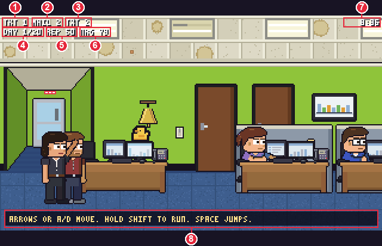
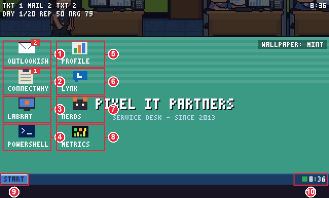
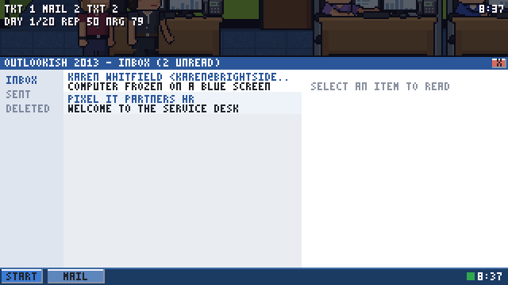
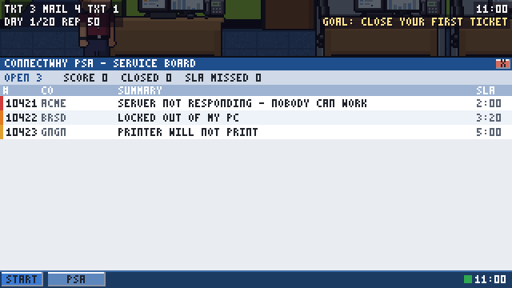
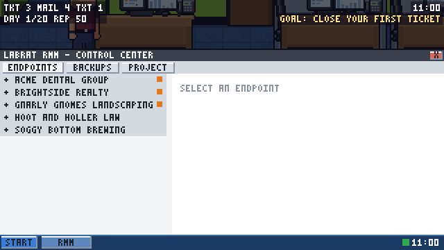
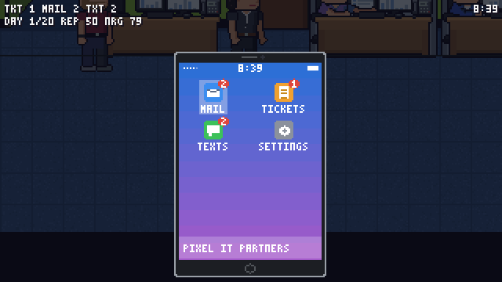

MSPSIM INSTRUCTION MANUAL &nbsp;|&nbsp; CHAPTER 5 &nbsp;|&nbsp; PAGE 18

# YOUR COMPUTER AND PHONE

*The two screens you will spend most of your working life looking at.*

---

## THE HUD (THE NUMBERS AT THE TOP)

Whenever you are walking around, a few small numbers sit in the top-left corner and the clock sits in the top-right. Tell your eyes
where to look first.

| # | READS | WHAT IT MEANS |
|---|---|---|
| **1** | `TKT n` | **Tickets** that are open. Zero is a good number to see. It will not last. |
| **2** | `MAIL n` | **Unread mail** in your inbox (it stops counting at 99, so you cannot be shamed past that). |
| **3** | `TXT n` | **Unread texts** on your phone. This shows up only when there is something waiting. |
| **4** | `DAY n/20` | **How far along you are.** Owner and Sales runs count `WEEK` instead of `DAY`. |
| **5** | `REP n` | **Reputation**: what the office and its clients think of your work. |
| **6** | `NRG n` | **Energy**, 0 to 100. Tech campaign only. It drains over the day. `ON CALL` appears next to it when you are carrying the pager. |
| **7** | `8:35` | **The office clock.** The working day runs on it. |
| **8** | *(bottom of the screen)* | **The hint bar.** A line of text in gold, showing hints, your current objective, or a short message after something happens. |

Other things you may see in the corner, depending on what you are doing:

| YOU SEE | MEANS |
|---|---|
| `IM n` | Unread **Lynk** instant messages. |
| `CASH $n` | Your company's cash (Owner campaign). |
| `WEEK n/20 Qn n% HRS n` | The week, the quarter, your progress to quota and the working hours you have left (Sales). |
| `YEAR 2` | You are in a Year 2 run. |
| `* NAME` | A "twist" is active in the world this week. |
| `DARTS n   Z FIRE (HOLD = FAR)   G AWAY` | You are holding the nerf blaster. `WAR n` appears too during a nerf war. |
| `AIMING n%   RELEASE Z TO FIRE` | You are lining up a long shot. |

> **TIP:** Press `F10` to hide the HUD for a clean picture. The clock and counters will come back when you press it again.

> **NOTE:** On the first working day of a Tech campaign, the hint bar teaches you the controls on a timer, one line at a time.

---

## YOUR COMPUTER

Sit at a desk and press **`E`**. The office fades back and a **2013 desktop** takes over the screen.

| # | WHAT | WHAT IT DOES |
|---|---|---|
| **1** | **OUTLOOKISH** | Your mail. |
| **2** | **CONNECTWHY** | The PSA (the service board): where tickets live. |
| **3** | **LABRAT** | The RMM (remote monitoring): where you fix things from a distance. |
| **4** | **POWERSHELL** | The PowerShell Academy: short lessons that make you faster. |
| **5** | **PROFILE** | Your skills and statistics. |
| **6** | **LYNK** | Instant messages with your coworkers. |
| **7** | **NERDS** | LabRat Nerds, the community forum and IRC channel. |
| **8** | **METRICS** | The office dashboard: tiles, charts and numbers, 2014 style. |
| **9** | **START** | A menu with every app on it, and **LOG OFF**. |
| **10** | **Network light and clock** | Green: the network is fine. Amber: no internet. Red: the cable is unplugged. |

Some modes add icons of their own: the Sales campaign has **SALESHOUND** (the customer relationship tool), campaigns that look
after the books have **BOARDROOM**, and the Service Manager has **DISPATCH** and **KNOWLEDGE**.

A red number on an icon is a count of things waiting (unread mail, open tickets, unread messages, red tiles on the dashboard).

### Using the computer

| ACTION | MOUSE | KEYBOARD | GAMEPAD |
|---|---|---|---|
| Open or press anything | Click | `Enter` | `A` |
| Move in a list | Wheel | `Up` / `Down` | D-pad |
| Step back one level | The **BACK** button | `Esc` | `B` |
| Close the computer | **START**, then **LOG OFF** | `Esc` (from a top-level screen) | `B` |

`Esc` steps out of anything nested (an open ticket, a message, a chat, a repair session) one level at a time. From a top-level screen, one more `Esc` closes the computer.

> **NOTE:** The computer is a mostly-mouse place. The keyboard covers the basics (move, open, back), but the mouse is faster and
> covers everything.

### When the network is down

If the cable at your desk is unplugged, the desktop says so in red: `NETWORK CABLE UNPLUGGED`. If the internet is down but the cable is
fine, it says `NO INTERNET ACCESS` in amber. Apps that need the network say `SERVER NOT AVAILABLE`. Your **phone is on cellular**,
so it keeps working.

> **WARNING:** Do not unplug the network closet during business hours. We have been over this.

---

## THE APPS

### OUTLOOKISH 2013 (mail)

An inbox on the left, a reading pane on the right. Click or `Enter` to open a message; **REPLY** and **DELETE** sit under it. Reading
a message marks it read. In the narrow shapes, the list and the message take turns on the screen, with a **BACK** button to
return.

### CONNECTWHY PSA (the service board)

Every job is a **ticket**. The board shows the open ones (a number, the client, a summary and an SLA timer), with counters at the
top for open, closed and missed.

> **NOTE:** **SLA** is the clock the client has been promised. When it runs out, the client notices.

Open a ticket and the buttons at the bottom are:

| BUTTON | WHAT IT DOES |
|---|---|
| **BACK** | Back to the list. |
| **TAKE** | Claim the ticket. |
| **PROGRESS** | Mark it as in progress. |
| **NOTE** | Add a note to its history. |
| **WAIT** | Park it while you wait for somebody. |
| **CLOSE** | Close it. If you have not fixed it, the game asks `CLOSE ANYWAY` or `KEEP WORKING`. |
| **GO ONSITE** | Appears on tickets that cannot be fixed from your desk. |

### LABRAT RMM (remote monitoring)

The RMM lists your clients and their machines. Pick a machine, **connect** to it, and choose how to fix it. There is usually more
than one way. Some are quicker, some are tidier, and some of the quick ones come back to see you later.

| TAB | WHAT IT SHOWS |
|---|---|
| **ENDPOINTS** | Every client and every machine, in a tree you scroll with the wheel or `Up` / `Down`. |
| **BACKUPS** | The state of each client's backups, with a **CHECK** button. Look at it more often than you would think. |
| **PROJECT** | Longer jobs. |

### POWERSHELL ACADEMY

Five short lessons, three questions each. Get two out of three right and you level up. Each level makes your fixes faster and
less likely to fail, and eventually unlocks scripts that you can run on one client, then on all of them.

### PROFILE

Your skills, your level and your numbers. Nothing in here bites.

### LYNK 2013 (instant messages)

A contact list with a coloured dot for each person's status and a red badge for unread messages. Pick someone to open the chat.
The buttons under the chat are short and friendly: **LUNCH?**, **NEED A HAND** and **THANKS!** Being nice here is not wasted effort.
When someone writes to you with a question, the answers appear as buttons.

> **NOTE:** Lynk needs the network cable, the same as everything else on your desk.

### LABRAT NERDS (the forum and IRC)

Two tabs: **FORUM** (boards and threads where you can read and answer questions, earning **karma** and a rank) and **IRC CHAT**
(a chat channel, where you can see who is around, pick what to talk about and join a conversation). It needs the internet, not just the
office network.

### METRICS

The office dashboard: a wall of numbers in glowing digits, with a chart of how the day is going. The same board is on the wall
TV (press `E` at the TV), read only.

---

## YOUR PHONE

Press **`P`** (or `Back` / `Select` on a gamepad). The phone slides up over the office.

The first time, you pick a phone: the **iFone 5** (a slate, iOS-style phone) or the **Nexxus 5** (Android-style). It changes the look and nothing
else. You can change your mind in **SETTINGS**.

| APP | WHAT IT DOES |
|---|---|
| **MAIL** | The same inbox as your computer. |
| **TICKETS** | A small version of the service board: look, **TAKE**, add a **NOTE**. Closing a ticket needs a computer (`CLOSING TICKETS NEEDS A COMPUTER`). |
| **TEXTS** | Messages from people who need you right now. Red badge when unread. |
| **CAMERA** (in the dock) | Point it at what is in front of you and press **SNAP** (`Enter`). `Down` opens the roll of your last six photos. A photo of the **patch panel** in the network closet keeps the jack tags as they read that day: a "no link" ticket on the phone then quotes the tag for that desk from your photo, and says whether it is one of Dan's printed tags (trust it) or hand-written tape (it may have drifted). |
| **SETTINGS** | Which phone you carry, the network (`CELLULAR 4G`: it works when the office network does not), a **TONE** row to change the ringtone, and **CAREER** to open your medals. |

| ACTION | KEYBOARD | MOUSE |
|---|---|---|
| Move | Arrows | Hover |
| Open | `Enter` | Click |
| Back | `Esc` | The back button |
| Put it away | `P` | none |

> **TIP:** The phone is the only screen that keeps working when the network does not. If the whole office goes quiet, check your
> pocket.

> **NOTE (COMING SOON):** The phone is getting a dialer, a lock screen and a notification banner. The apps above stay. Where the
> new screens change a step, this page will be updated.

&lt;&lt; Previous: [Chapter 4](04-the-office.md) &nbsp;|&nbsp; [Contents](README.md) &nbsp;|&nbsp; Next: [Chapter 6: After Work](06-after-work.md) &gt;&gt;
