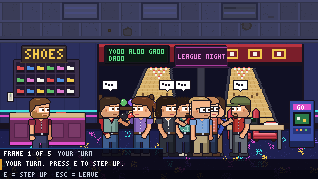

MSPSIM INSTRUCTION MANUAL &nbsp;|&nbsp; CHAPTER 6 &nbsp;|&nbsp; PAGE 23

# AFTER WORK

*Seven ways to spend an evening with people you spend every other hour with, and one quick game any time.*

---

## HOW OUTINGS WORK

Now and then somebody suggests that the team goes out. You can say **yes** or **no** (but see the note on skipping). If you go, the
game takes you and the crew to the venue, plays one little game, and brings you back.

In **Free Play** you can start one yourself: press **`O`**, answer **LET'S GO**, then choose where.

| GAME | WHERE | YOU DO |
|---|---|---|
| **Bowling** | The bowling alley | Timing: stop two moving markers in the green. |
| **Karaoke** | The karaoke bar | Rhythm: hit the arrows as they reach the line. |
| **Escape Room** | The escape room | Puzzle: find clues, crack a code. |
| **Dinner** | The neighbourhood grill | Conversation: learn what everybody likes. |
| **Chair Race** | The warehouse | Rhythm: race the crew on rolling office chairs. |
| **Paintball** | The old west main street | Action: capture the flag, three a side, with paintballs. |
| **Cornhole** | The warehouse | Timing: toss bags at the boards. |
| **Cookout** | The warehouse dock | Speed: run the grill and serve the orders. |

### Everything every game has in common

| STEP | WHAT HAPPENS |
|---|---|
| **The intro page** | A short description and the keys at the bottom. Press `Enter` or `Space` to start. `Esc` to leave. |
| **The game** | You play it. Your coworkers play with you, and react. |
| **The result page** | **0 to 3 stars.** `Enter`, `Space` or `Esc` to carry on. |

| CONTROL | KEYBOARD | GAMEPAD |
|---|---|---|
| Arrows | Arrow keys | D-pad or left stick |
| Confirm | `Enter` | `A` |
| `E` | `E` | `X` |
| Leave | `Esc` | `B` |

> **NOTE:** In a campaign, leaving early is allowed, but nobody says anything and everybody notices. Skipping an invitation costs a
> little goodwill too. The Owner campaign charges the company for the evening.

> **TIP:** In a room-based game (all of them are, at the time of writing) you can keep walking around between turns.
> The game only listens for its own keys while you play.

---

## BOWLING

Five frames against your coworkers.

1. It is your turn when the caption says so: press **`E`** (or `Space`) to step up.
2. A marker sweeps from side to side across the lane. Press **`E`** to stop it **in the green**: that is your aim.
3. A second marker swings for **power**. Press **`E`** again, once more in the green.
4. Watch the pins fall. Repeat for your second roll.

| KEY | WHAT IT DOES |
|---|---|
| `E` / `Space` | Step up, stop the aim, stop the power. |
| `Left` / `Right` | While the markers are moving: **hook** the ball that way. Press the same direction again to cancel. A hook moves the green zone, and a wild one can leave the lane. |
| `Esc` | Leave. |

> **TIP:** Hooks are for people who have been doing this a while.

---

## KARAOKE

Take the mic. A card lets you **pick the song** (`Up` / `Down` then `Enter`, or press `1` to `4`). Notes scroll toward a line. As
each one reaches it, press the matching arrow.

| KEY | WHAT IT DOES |
|---|---|
| `Left` `Up` `Down` `Right` | Hit the note in that lane. |
| `Esc` | Leave. |

Four lanes, four colours, one microphone, and the whole room right there with you. Some songs are locked until you earn them.

> **NOTE:** Nervous? The room is right there with you. If you do well, the whole room joins the chorus.

---

## ESCAPE ROOM

Crack the code on the keypad before time runs out. The code is a few digits long (three on some levels, four on others).

1. **Look around.** Stand at the chalkboard, the clock, the painting and the shelf and press **`E`**. Each shows a clue.
2. **Find the keypad** and press `E` to start entering a guess.
3. **`Left` / `Right`** choose a digit, **`Up` / `Down`** change it, **`Enter`** tries the code.
4. The door tells you how you did: **bulls** are the right digit in the right place, **cows** are the right digit in the wrong place.
5. You have a limited number of tries and a time limit.

| KEY | WHAT IT DOES |
|---|---|
| `E` | Examine a clue; use the keypad. |
| `Left` `Right` `Up` `Down` | Choose and change digits. |
| `Enter` | Try the code. |
| `N` | Ask a friend for a **nudge**. Use too many and the stars shrink. |
| `Esc` | Stop entering. Press it again to leave. |

> **TIP:** Your friends know more than they say. A hint from the right person is a good use of a nudge.

---

## DINNER

A booth at the neighbourhood grill. Everyone at the table loves something and dreads something else.

1. Press **`E`** on the booth to sit with the team.
2. Over five rounds, **pick a topic**: `Up` / `Down` then `Enter`.
3. Watch their faces. A topic somebody likes goes well; one they dread does not. Remember who liked what.

| KEY | WHAT IT DOES |
|---|---|
| `E` | Sit down at the booth. |
| `Up` / `Down` | Choose a topic. |
| `Enter` | Say it. |
| `Esc` | Leave. |

> **TIP:** There is no skill check here, so no mastery. It is purely about listening. (You will find this harder than the
> bowling.)

> **NOTE:** In the Owner campaign you also set the budget for the evening before you sit down.

---

## CHAIR RACE

Race the crew down the length of the warehouse on rolling office chairs.

| KEY | WHAT IT DOES |
|---|---|
| `Z` then `X` then `Z`... | Push off, alternating the two keys. **A steady rhythm is fast.** Mashing tires you out. |
| `Up` / `Down` (or `W` / `S`) | Change lane. |
| `Esc` | Leave. |

Cones, signs and boxes cost time. The gamepad's `A` and `B` stand for `Z` and `X`.

The card that opens the race offers three events. Press **`Left`** / **`Right`** on it before you start:

| EVENT | WHAT IT IS |
|---|---|
| **THE STRAIGHT** | The long room, start line to finish line. Three checkpoints. |
| **THE GAUNTLET** | Shorter and tighter. Every gap is one lane over from the last, so you weave the whole way. It keeps its own best time. |
| **CHAIR FIGHT** | A duel with one of the crew on a strip of floor, first to three bumps. The rest watch. |

**The chair fight.** `Z` and `X` push you the way you face, exactly as in the race. **`Left`** / **`Right`** spin the chair around (it takes a moment, and you cannot push while it turns). `Up` / `Down` change lane. When the chairs meet in one lane, the one rolling clearly faster lands a **bump**: the other chair is knocked back and spins, dizzy, for a second. About the same speed is a clash and nobody scores. In another lane the chairs roll past each other, and a chair with its back to you is bumped as soon as you are fast enough. After 75 seconds the most bumps win.

> **TIP:** Watch the rhythm, not the chair.

---

## PAINTBALL

Capture the flag on a western main street, three a side: you and two of the crew against three more. Your flag stands in front of the saloon on the left, theirs in front of the jail on the right.

| KEY | WHAT IT DOES |
|---|---|
| `Left` / `Right` (or `A` / `D`) | Run. You face the way you run. |
| `Up` / `Down` (or `W` / `S`) | Change lane. The street is three lanes wide and a shot only finds somebody in your own lane. |
| `Z` (or `E`, or the pad's `A` / `X`) | Fire a paintball the way you face, at whoever is in your lane. |
| Hold `Shift` (the pad's `B`) | Duck. Right behind a barricade, a ducking player cannot be hit from that side; in the open it only makes you a smaller target. You cannot fire while ducking. |
| `Esc` | Leave. |

A tag puts a player out for four seconds and drops the flag they carried. Touch the other team's flag to pick it up, carry it back to your own end to score. Touch your own flag, if it was dropped, to send it home. First to three captures wins; at 2:30 the higher score wins. It costs $200 in the owner campaign.

About one evening in three is a **night match**: the street is dark, the saloon windows are lit, every shot flashes, and a paintball only flies about four fifths as far, for both teams. Press **`Left`** / **`Right`** on the card before you start to pick day or night yourself.

With **two players**, player 2 takes the place of your first team mate and plays with their own gamepad: the stick runs, D-pad `Up` / `Down` change lane, `A` or `X` fires, hold `B` to duck. The other team shoots a little straighter to make up for it.

> **TIP:** A runner is harder to hit than somebody standing still, and a ducking player behind a barricade cannot be hit at all. Duck, wait for the shot, pop up. Changing lane is a dodge: whoever was shooting at you has to notice and follow you over, and that takes them a moment.

---

## CORNHOLE

Toss bags at the boards in the warehouse against the crew. Four bags each.

1. Press **`E`** to stop the **aim** sweeping across the board.
2. Press **`E`** again to stop the **power**.
3. A bag in the **hole** is worth 3. A bag on the **board** is worth 1. Bags that land against each other cancel out. First to the target wins.

| KEY | WHAT IT DOES |
|---|---|
| `E` / `Space` / `Enter` | Stop the aim, stop the power. |
| `Esc` | Leave. |

---

## COOKOUT

You are on the grill at the warehouse dock. Orders arrive from the crew: burgers, hot dogs, all of it cooked the way it was asked
for. Serve each order **the way it was asked**, and keep an eye out for flare-ups.

| KEY | WHAT IT DOES |
|---|---|
| `Left` / `Right` (or `A` / `D`) | Pick a patty. |
| `E` | Flip it. |
| `Space` / `Enter` | Serve it. |
| `Shift` | Move it to the cool side (`B` on a gamepad). |
| `Esc` | Leave. |

> **WARNING:** The grill is not insured against enthusiasm.

---

## DARTS

Not an evening out: a quick round at the dart board in the warehouse, whenever you like. Press **`E`** at the board, choose **LET'S PLAY**, and
one or two coworkers (Alan, Garrison, Dan, Maya or John, whoever is up for it) take turns with you. Three darts a turn, three rounds, highest total wins.

1. A **reticle** drifts across the board. Press **`E`** and the dart goes wherever it is. There is a little scatter, so nobody is perfect.
2. The wobble **settles for a moment** (about a second in) and then your arm tires, so there is a moment to wait for. Every dart has a **new sweet spot**: the loop's centre and speed move from dart to dart.
3. The **bull** is 50, the outer bull 25, the thin **treble** ring counts three times its number, the outer **double** ring twice. Anything else is the number of its wedge. Off the board is nothing.
4. The zoomed board in the corner shows this turn's darts and the reticle. The ring around the reticle is smaller when the wobble is steady.

| KEY | WHAT IT DOES |
|---|---|
| `E` / `Space` / `Enter` | Throw. |
| `Esc` | Leave. No stars, and nobody minds. |

Stars: win by **40 or more** for three, win for two, a tie or a narrow loss for one. In **Free Play** nothing is scored. In a **campaign** a round takes about
**a quarter of an hour** on the clock, gives **a little energy** (the first two rounds of the day) and, the first round of the day, a little more goodwill with the
people who played. It never counts as an outing and the owner pays nothing. A **bullseye** earns the **BULLSEYE** medal. Darts also get sharper the more you play them well,
like everything else here.

> **TIP:** Do not throw in the first second. Wait for the wobble to settle, then press as the reticle crosses the bull.

---

## STARS AND GETTING SHARPER

Every game ends with **0 to 3 stars**. Stars are how the team felt about the evening: good results make people like you more,
and a three-star night is the kind of thing that gets talked about.

Every game also **gets sharper the more you play it well**:

- A **good** play is 2 or more stars, and you stayed to the end.
- Each good play adds one to that game's **mastery**, up to **10**.
- As mastery rises, the game's skill checks tighten: the markers swing a little faster, the windows shrink a little.
- The result page tells you, with a line like `MASTERY 3/10. SHARPER NEXT TIME.` At the top it reads `FULL MASTERY.`

So your hundredth game of bowling is not the same as your first. Replays stay interesting because you keep getting better and the
game keeps keeping up.

> **NOTE:** Dinner has no skill check, so it has no mastery line. Toolbox games set to a "fixed take" are meant to repeat exactly, so they stay at the starting difficulty.

> **TIP:** The difficulty level (EASY, NORMAL, HARD) sets where the game starts. Mastery changes how it feels from there.

&lt;&lt; Previous: [Chapter 5](05-your-computer-and-phone.md) &nbsp;|&nbsp; [Contents](README.md) &nbsp;|&nbsp; Next: [Chapter 7: Make Your Own](07-make-your-own.md) &gt;&gt;
