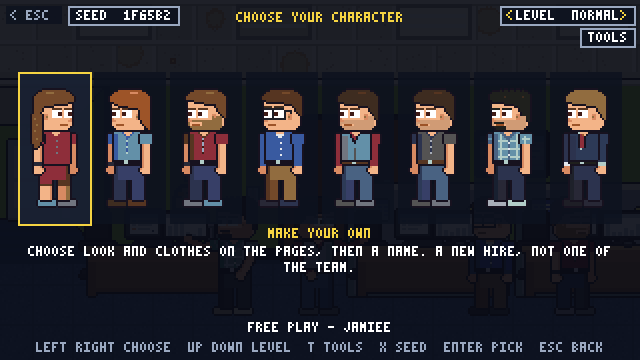
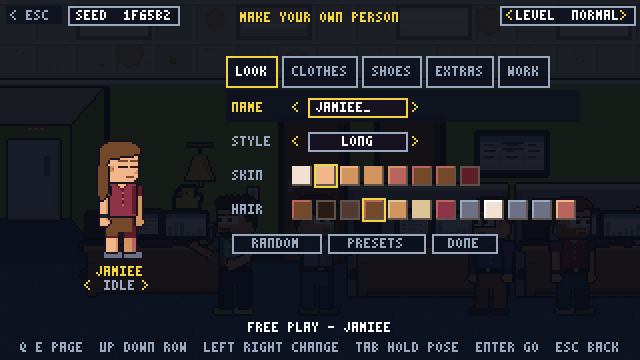
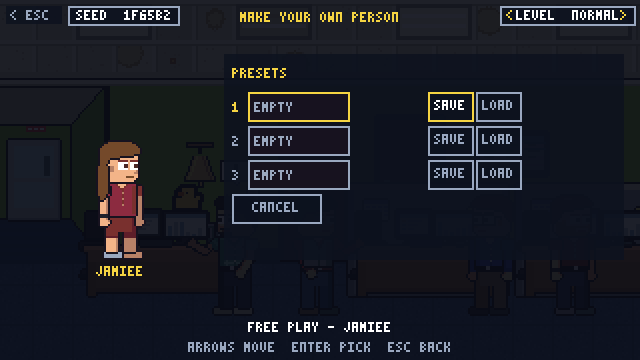

MSPSIM INSTRUCTION MANUAL &nbsp;|&nbsp; CHAPTER 7 &nbsp;|&nbsp; PAGE 27

# MAKE YOUR OWN

*Hair, glasses, a very specific shirt: the character creator, and how to change your mind later.*

---

## WHERE IT LIVES

The creator is the **MAKE YOUR OWN** card at the end of the character select row. It is offered in the **Tech Campaign** and in
**Free Play**. The other campaigns play someone who already works at the office (the Owner campaign, for example, lets you choose
between the two owners).

Choose the card with `Left` / `Right`, press `Enter`, and the creator opens.

> **NOTE (COMING SOON):** The select screen is being simplified so that it opens straight into the creator, with a line of presets
> along the bottom. Everything below still applies. Only the route to it changes.

---

## THE CREATOR

A **preview person** stands on the left and wears every change as you make it. They also move: they cycle through a series of
little poses (idle, walk, wave, sit, type, stretch, scratch, look, yawn, nod, phone, mouse, slump and toss), so you can judge a hat
sitting down as well as standing up.

The right side is made of **five pages** (tabs along the top), each with a few rows, and a bottom row of three buttons.

| PAGE | ROWS |
|---|---|
| **LOOK** | `NAME`, `STYLE` (ten hairstyles), `SKIN`, `HAIR` colour |
| **CLOTHES** | `TOP`, `SHIRT` colour, `PATTERN`, `BOTTOM`, `PANTS` colour |
| **SHOES** | `SHOES`, `COLOR` |
| **EXTRAS** | `GLASSES`, `BEARD`, `HAT` |
| **WORK** | `NAMETAG`, `LANYARD`, `WATCH` |

| BOTTOM ROW | WHAT IT DOES |
|---|---|
| **RANDOM** | Roll a random look. Press it until something amuses you. |
| **PRESETS** | Open the preset slots (below). |
| **DONE** | Keep this person and carry on. |

### Keys

| ACTION | KEYBOARD | GAMEPAD |
|---|---|---|
| Move between rows | `Up` / `Down` (the last stop is the bottom row) | D-pad / stick |
| Change a row | `Left` / `Right` | D-pad / stick |
| Turn the page | `Q` / `E` or `PageUp` / `PageDown` | `LB` / `RB` |
| Press a bottom-row button | `Enter` | `A` |
| Hold the preview's pose | `Tab` | `Y` |
| Step the preview's pose | `,` and `.` | none |
| Back out | `Esc` | `B` |
| Change picture shape | `F9` | none |

> **TIP:** On the **NAME** row, `Q` and `E` are letters, not page-turners, because you are typing. Use `PageUp` / `PageDown`
> there.

### Names

Go to the **NAME** row (it is the first one) and type: letters, digits, spaces and dashes, up to **ten characters**. `Backspace` deletes. Left
and right on the NAME row cycle through a few ready-made names if you cannot decide, and an empty name is quietly replaced by one.

On a gamepad, pressing `A` on the NAME row opens a **letter grid** (A to Z and a dash, then `SP`, `DEL` and `DONE`). Move around it
with the D-pad and press `A` to type.

---

## PRESETS

Made somebody you love? There are **three preset slots**. The **PRESETS** button opens a list:

| SLOT ROW | WHAT IT DOES |
|---|---|
| **1, 2, 3** with **SAVE** / **LOAD** | `Left` / `Right` pick the button, `Enter` presses it. **SAVE** keeps the current person (accessories included) in that slot. **LOAD** brings them back. An empty slot says `THAT SLOT IS EMPTY`. |
| **CANCEL** | Close the list. |

Presets are kept between runs in the game's settings file, so your favourite people are waiting for you next time.

---

## UNLOCKS

Not everything is in the box on day one. Some hairstyles, shirts, hats and other accessories are **unlocked** by earning
**medals** in your [Career](03-game-modes.md#career). On the accessory rows, anything still locked shows an `N LOCKED` note beside the choices, and
the styles you cannot use yet are not there to pick.

> **TIP:** If you have a look you cannot recreate from memory, save it to a preset. A preset keeps accessories, and
> a preset that includes something you later lose will not crash anything: the item quietly becomes "none".

---

## CHANGING YOUR OUTFIT LATER

In **Free Play** you can open the creator over the room at any time:

- Press **`Y`**, **or**
- Pause (`Esc`) and choose **OUTFIT**.

The person in the room wears each change live. **DONE** keeps the new look (and saves it as your default for the next run), and
`Esc` puts your old look back.

> **NOTE:** The `1` to `7` keys in Free Play swap you into one of the stock people instead, such as the intern or Vic. `Y` is for
> your own custom person.

---

## IN THE CAMPAIGNS: YOUR STARTING BUILD

In the campaigns, the select flow has one more stop after your look: a **build** screen where you spend a handful
of points on your starting skills and pick up to two **quirks** (a quirk may give you extra points or cost some). Up and down
move between rows, left and right change them, and `P` cycles through some ready-made builds. How many points you have depends on
your level: more on Easy, fewer on Hard.

Tech players are also asked which phone they carry.

&lt;&lt; Previous: [Chapter 6](06-after-work.md) &nbsp;|&nbsp; [Contents](README.md) &nbsp;|&nbsp; Next: [Chapter 8: Tips and Troubleshooting](08-tips-and-troubleshooting.md) &gt;&gt;
