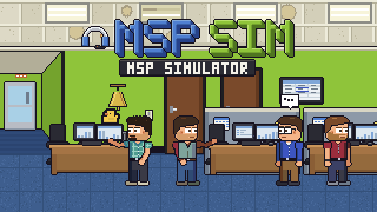

MSPSIM INSTRUCTION MANUAL &nbsp;|&nbsp; CONTENTS &nbsp;|&nbsp; PAGE 1

# MSPSim INSTRUCTION MANUAL

**PIXEL IT PARTNERS INTERACTIVE** &nbsp;|&nbsp; RATED E FOR EVERYONE: *Mild IT Jargon, Cartoon Nerf Violence, Coffee Machine Opinions*

Welcome to the full manual. It explains **how to get around** the game: the controls, the menus, the building, the screens and the
games. It does **not** explain what happens in it. This lovely story would like to be found out in its own time.

> **NOTE:** MSPSim is private and in progress. If a page and the game disagree, believe the game. If you can, tell us.

---

## CONTENTS

| CH. | TITLE | PAGE | IN THIS CHAPTER |
|---:|---|---:|---|
| 1 | [**Getting Started**](01-getting-started.md) | 2 | Switching it on, the title screen and menu, difficulty (and cozy Easy), the seed, save slots, the pause menu |
| 2 | [**Controls**](02-controls.md) | 6 | Every key and button, standing and seated, the `Tab` selection, the nerf blaster, gamepad |
| 3 | [**Game Modes**](03-game-modes.md) | 10 | Tech, Owner, Service Manager, Sales, Free Play, Career, Year 2 |
| 4 | [**The Office**](04-the-office.md) | 13 | A map and a tour: rooms, doors, things to poke, the network closet, client sites |
| 5 | [**Your Computer and Phone**](05-your-computer-and-phone.md) | 18 | The HUD counters, the apps, the phone |
| 6 | [**After Work**](06-after-work.md) | 23 | Bowling, karaoke, escape room, dinner, chair race, cornhole, cookout; stars and mastery |
| 7 | [**Make Your Own**](07-make-your-own.md) | 27 | The character creator, presets, outfits, unlocks |
| 8 | [**Tips and Troubleshooting**](08-tips-and-troubleshooting.md) | 30 | Tips, questions and answers, the Free Play toolbox |
| 9 | [**Credits and Legal**](09-credits-and-legal.md) | 33 | The limited warranty, notices, credits and customer support |

---

## IF YOU ARE IN A HURRY

| I WANT TO... | GO TO |
|---|---|
| Just start | [Chapter 1](01-getting-started.md#switching-it-on) |
| Know which key does what | [Chapter 2](02-controls.md) |
| Know what the numbers at the top mean | [Chapter 5: the HUD](05-your-computer-and-phone.md#the-hud-the-numbers-at-the-top) |
| Find a room | [Chapter 4: the map](04-the-office.md#the-map) |
| Change the screen size | [Chapter 8](08-tips-and-troubleshooting.md#my-screen-is-tiny) or press `F9` |
| Make the game easier (or harder) | [Chapter 1: difficulty](01-getting-started.md#difficulty) |
| Dress somebody up | [Chapter 7](07-make-your-own.md) |
| Complain | [Chapter 9: customer support](09-credits-and-legal.md#customer-support) |

---

## SYMBOLS USED IN THIS MANUAL

> **NOTE:** Something worth knowing.

> **TIP:** Something that will make your day a little easier.

> **WARNING:** Something that, if ignored, will make your day a little longer. Do not unplug the network closet during business
> hours.

> **NOTE (COMING SOON):** Something that is being changed, and a page that will be updated when it is.

`E` &nbsp;A key on the keyboard. &nbsp;&nbsp; **`BACK`** &nbsp;A button on a screen or a gamepad. &nbsp;&nbsp; `TKT 3` &nbsp;Text exactly as the game shows it.

---

## ALSO IN THE BOX

- [The front page](../../README.md): requirements, how to run, the controls on one screen.
- [`docs/GAME_BIBLE.md`](../GAME_BIBLE.md): the pitch, the cast and the story. **Spoilers.** You have been warned, in bold.

[Chapter 1: Getting Started](01-getting-started.md) &gt;&gt;
